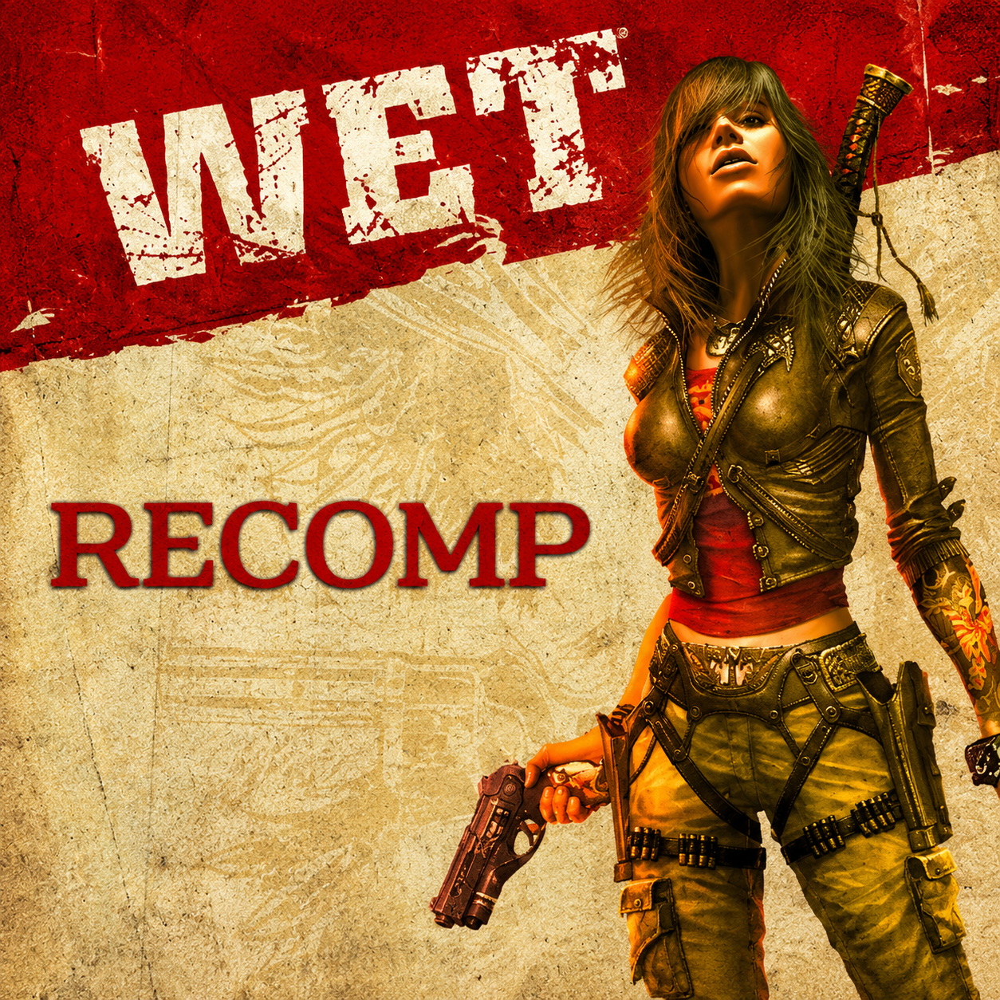

# WET Recomp - Nintendo Switch

<div align="center">
  
</div>

A Nintendo Switch build of [**WET**](https://en.wikipedia.org/wiki/Wet_(video_game)) (Xbox 360, Title ID `425307DB`) using ReXGlue and Deko3D.

## Requirements

- CMake 3.25+, Ninja, and devkitPro's Switch toolchain (`devkitA64`, `libnx`, and `deko3d`)
- The ReXGlue NX SDK at `../rexglue-nx-source`; run `python tools/switch_setup.py` in that SDK to fetch its Switch dependencies
- [extract-xiso](https://github.com/XboxDev/extract-xiso/releases) and your own copy of WET

## Game data

Extract your Xbox 360 ISO with `extract-xiso.exe -x WET.iso`, then copy the game data into `assets/` (gitignored):

```
assets/
  default.xex
  nxeart
  lu0/  lu1/
  media/  movies0/  movies1/
  streams0/  streams1/
```

## Build

```powershell
cmake --preset switch-release
cmake --build --preset switch-release --parallel 2
```

The NRO is `build\switch\wetrecomp.nro`. Copy it and `assets\` to the same folder on the SD card, for example `sdmc:/switch/wetrecomp/`.

## Configuration

`settings/hardware.toml` and `settings/mapping.toml` are loaded at startup. The WET options include language, frame-rate, visual-effect, and GPU-wait settings; see [`settings/README.md`](settings/README.md).

## Credits

- ReXGlue NX SDK
- [extract-xiso](https://github.com/XboxDev/extract-xiso)
